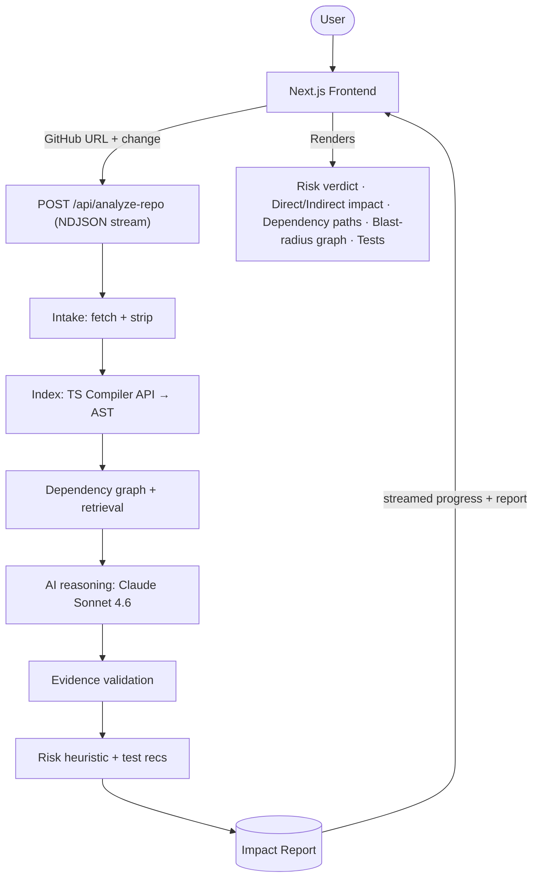

# ImpactIQ

**Know what your change will break — before you write a line of code.**

Point ImpactIQ at a GitHub repository, describe a change in plain English, and it predicts the blast radius: which files are affected, *why*, how risky it is, and which tests to write — every finding backed by a real file, symbol, and line you can click to verify.

Powered by Claude Sonnet 4.6 · Next.js 16 · TypeScript

---

## 🔗 Live

**https://impactiq-three.vercel.app**

Click **“Try the demo”** on the landing page to see a full impact report instantly — no API key or setup needed.

---

## The Problem

Engineers ship changes that silently break other parts of a codebase. The blast radius isn’t discovered until code review, staging, or — worse — production. Dependency chains are transitive and tedious to trace by hand.

ImpactIQ reads the actual code, builds a dependency graph, and reasons about your proposed change against it — so you see the ripple effect up front, grounded in evidence rather than guesswork.

---

## How It Works

ImpactIQ runs a deterministic analysis pipeline and only hands a **bounded, evidence-backed** slice of the code to the AI. Facts come from the code; the model only interprets them.

```
Intake → Index → Dependency graph → AI reasoning → Validation → Risk → Report
```

| Stage | What happens |
|-------|--------------|
| **Intake** | Fetch the repo (GitHub zipball or uploaded ZIP), read it **in memory — never executed**. `node_modules`, secrets, and binaries are stripped. |
| **Index** | Parse every `.ts/.tsx/.js/.jsx` file with the **TypeScript Compiler API** into a real AST — files, exported symbols, and import/export edges with line numbers. |
| **Dependency graph** | Build who-imports-what, then lexically match the change description to seed files and trace their transitive dependents (the blast radius). |
| **AI reasoning** | Claude reasons over the bounded candidate set and proposes findings — each citing a file, symbol, and line. |
| **Validation** | Every citation is checked against the index. Fabricated files are **rejected**; off-by-one symbols/lines are flagged. No hallucinated impacts. |
| **Risk & tests** | A transparent 0–100 heuristic scores risk from named factors; test recommendations are tied to the impacted files. |
| **Report** | Assembled into an interactive report, exportable as Markdown or JSON. |

---

## Features

- **Evidence-backed findings** — every impact cites a real file / symbol / line, verified against the AST. Fabrications are dropped.
- **Clear impact classification** — findings are graph-derived into **Direct**, **Indirect**, and **Potential**, with a one-line reason for each (confidence is a separate axis).
- **Clickable dependency paths** — for every indirect finding, see the import chain from the file down to the change target, with each hop openable to its source.
- **Repository health summary** — files, symbols, imports, tests, plus skipped files and unresolved imports, so you know how complete the analysis was.
- **Blast-radius graph** — a visual map of how the change spreads, laid out by import hops.
- **Risk score & recommended tests** — a documented heuristic, not a black box.
- **Sample demo mode** — try the full report flow instantly on a prepared sample repo, no API key required.

---

## Tech Stack

| Layer | Technology |
|-------|-----------|
| Framework | Next.js 16 (App Router) |
| Language | TypeScript |
| AI Model | Claude Sonnet 4.6 (`claude-sonnet-4-6`) |
| Code analysis | TypeScript Compiler API (AST) |
| Repo intake | `fflate` (in-memory ZIP) |
| Validation | Zod |
| Styling | Tailwind CSS v4 · Inter |
| Deployment | Vercel |

---

## Run Locally

```bash
# 1. Clone
git clone https://github.com/KJChandru/ImpactIQ.git
cd ImpactIQ

# 2. Install
npm install

# 3. Add your Anthropic API key
echo "ANTHROPIC_API_KEY=sk-ant-..." > .env.local

# 4. Start
npm run dev
```

Open [http://localhost:3000](http://localhost:3000). Click **“Try the demo”** to explore a report without an API key.

---

## Architecture



---

## API Reference

### `POST /api/analyze-repo`

Streams newline-delimited JSON (NDJSON) progress events, ending with the full report.

```jsonc
// Request
{
  "githubUrl": "https://github.com/owner/repo",   // or "zipBase64": "<base64 .zip>"
  "changeRequest": "Add a once() method that auto-removes the handler after the first call"
}

// Streamed events (one JSON object per line)
{ "stage": "fetching", "source": "owner/repo" }
{ "stage": "indexed", "fileCount": 42, "languages": ["typescript"] }
{ "stage": "retrieved", "seeds": 1, "candidates": 12 }
{ "stage": "reasoning" }
{ "stage": "verifying" }
{ "stage": "done", "report": { /* full RepoImpactReport */ } }
```

The final `report` includes: `summary`, `risk` (level + score + factors), `findings` (grouped Direct/Indirect/Potential, each with evidence, a code snippet, and a dependency path), `testRecommendations`, `health`, `graph`, and `assumptions` / `limitations`.

> Repositories are analyzed in memory and **never executed**; secrets and `node_modules` are stripped during intake.

---

## License

MIT
