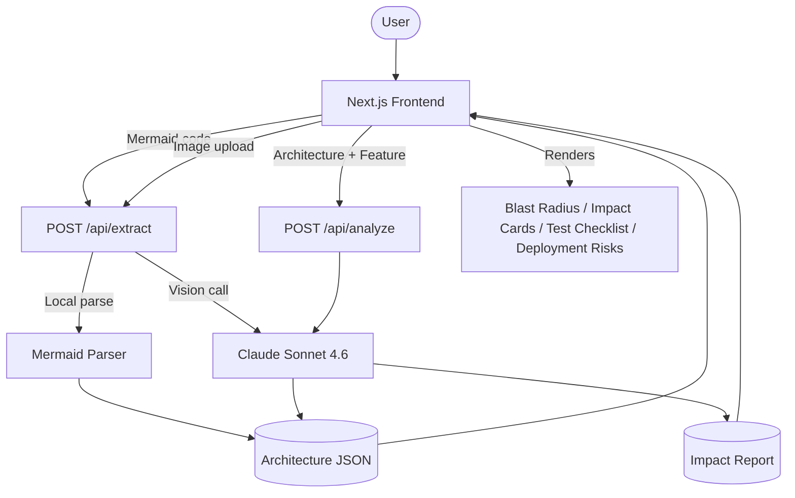

# ImpactIQ

**Architectural Impact Analyst** — Know what your feature will break before you write a single line of code.

Built for the [Lyzr Builder Challenge](https://lyzr.ai) · Powered by Claude Sonnet 4.6 · GitAgent v0.1.7

---

## The Problem

Engineers ship features that silently break other parts of the system. The blast radius isn't discovered until staging, or worse — production. Dependency graphs are complex, transitive, and impossible to reason about manually. ImpactIQ takes your architecture diagram and a plain-English feature description and instantly maps every module at risk, hidden transitive dependencies, a full test checklist, and deployment warnings.

---

## Live Demo

Live Demo: https://impactiq-three.vercel.app/

Click **"Try the demo"** on the landing page to see a full OAuth migration impact report instantly — no API key needed.

---

## How It Works

ImpactIQ runs a three-phase AI pipeline:

```
Ingestion → Decomposition → Diagnostic
```

| Phase | What happens |
|-------|-------------|
| **Ingestion** | Upload a Mermaid diagram or architecture image. Claude Vision or the local Mermaid parser extracts all modules and dependency edges into a structured graph. |
| **Decomposition** | Describe your feature in plain English. Claude traces the dependency graph, computes which modules fall within the blast radius, and flags transitive risks you'd likely miss. |
| **Diagnostic** | Full impact report: blast radius count, per-module severity with reasoning, hidden dependencies, an interactive test checklist with copy-all, and deployment risk warnings. |

### SkillsFlow Pipeline

```yaml
# workflows/impact-flow.yaml
steps:
  1. ingest_diagram    → extract modules + dependencies
  2. validate_graph    → Zod schema validation
  3. trace_blast       → Claude analyzes feature impact
  4. surface_risks     → hidden deps + deployment risks
  5. generate_tests    → per-module test checklist
```

---

## Tech Stack

| Layer | Technology |
|-------|-----------|
| Framework | Next.js 16 (App Router) |
| Language | TypeScript |
| AI Model | Claude Sonnet 4.6 (`claude-sonnet-4-6`) |
| State | Zustand |
| Validation | Zod |
| Agent | GitAgent v0.1.7 |
| Styling | Tailwind CSS v4 |
| Deployment | Vercel |

---

## GitAgent Structure

```
impactiq/
├── agent.yaml              ← GitAgent manifest (id, version, model, skills)
├── SOUL.md                 ← Agent identity and personality
├── RULES.md                ← Hard constraints (never hallucinate modules, etc.)
├── skills/
│   ├── EXTRACT_SKILL.md    ← Diagram ingestion skill
│   ├── ANALYZE_SKILL.md    ← Blast radius analysis skill
│   └── REPORT_SKILL.md     ← Report generation skill
├── tools/
│   ├── extract.yaml        ← MCP tool schema: POST /api/extract
│   └── analyze.yaml        ← MCP tool schema: POST /api/analyze
└── workflows/
    └── impact-flow.yaml    ← 5-step SkillsFlow pipeline
```

---

## Run Locally

```bash
# 1. Clone
git clone https://github.com/<your-username>/impactiq.git
cd impactiq

# 2. Install
npm install

# 3. Add your Anthropic API key
echo "ANTHROPIC_API_KEY=sk-ant-..." > .env.local

# 4. Start
npm run dev
```

Open [http://localhost:3000](http://localhost:3000). Click **"Try the demo"** to test without an API key.

---

## Architecture



---

## API Reference

### `POST /api/extract`

Extracts architecture from a diagram.

```json
// Request (Mermaid)
{ "mermaid": "graph TD\n  A[Auth] --> B[(DB)]" }

// Request (Image)
{ "image": "<base64>", "mediaType": "image/png" }

// Response
{
  "modules": ["Auth", "DB"],
  "dependencies": [{ "from": "Auth", "to": "DB" }],
  "confidence": 0.95
}
```

### `POST /api/analyze`

Computes full impact report.

```json
// Request
{
  "architecture": { "modules": [...], "dependencies": [...] },
  "feature": "Add OAuth 2.0 login with Google"
}

// Response
{
  "blastRadius": 4,
  "impacted": [{ "module": "Auth", "severity": "high", "reason": "..." }],
  "hiddenDeps": [{ "from": "Notifications", "to": "Auth", "risk": "..." }],
  "tests": [{ "module": "Auth", "cases": ["..."] }],
  "deploymentRisks": ["..."]
}
```

---

## License

MIT
